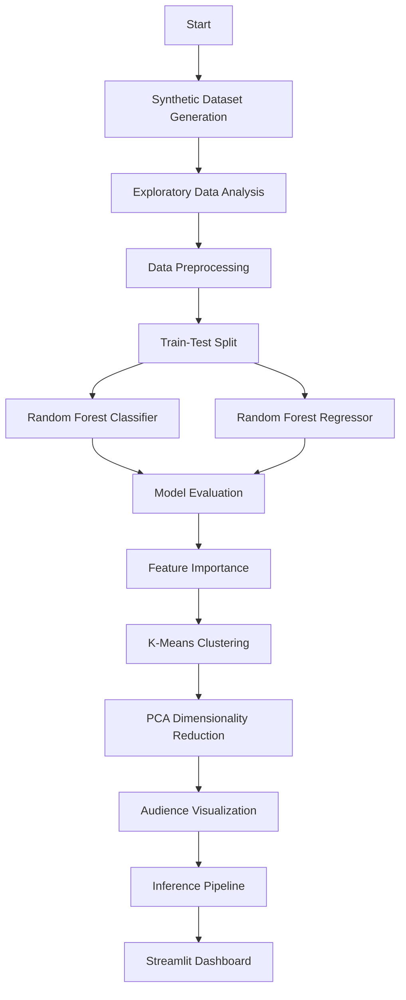

# 📱 AI-Powered Social Media Content & Audience Predictor

An interactive Machine Learning application built using **Python and Streamlit** that predicts the potential performance of short-form social media content, estimates engagement rates, identifies audience segments, and visualizes audience behaviour.

The project combines supervised and unsupervised machine learning techniques to explore how different content characteristics and audience attributes can influence social media engagement.

> **Disclaimer:** This is an educational undergraduate machine learning project trained entirely on a **synthetic dataset**. It does not access, reproduce, or predict Instagram's or any other social media platform's actual recommendation algorithm. All predictions and insights are based on patterns learned from the generated dataset.

---

## 🚀 Project Overview

The AI-Powered Social Media Content & Audience Predictor aims to demonstrate how machine learning can be applied to social media analytics.

Users can input characteristics of a short-form video post, such as its content category, duration, posting time, hashtags, and other engagement-related attributes. The application then generates predictions and visual insights using trained machine learning models.

The project is divided into four major phases:

| Phase | Description |
|---|---|
| Phase 1 | Synthetic Dataset Generation & Exploratory Data Analysis |
| Phase 2 | Supervised Learning: Classification & Regression |
| Phase 3 | Audience Segmentation using Clustering & PCA |
| Phase 4 | Prediction Interface and Interactive Dashboard |

---

## ✨ Key Features

- **Performance Prediction:** Classifies a social media post into Low, Medium, or High performance categories.
- **Engagement Rate Estimation:** Predicts the expected engagement rate as a percentage.
- **Audience Segmentation:** Identifies distinct audience groups using K-Means clustering.
- **Audience Visualization:** Uses Principal Component Analysis (PCA) to represent audience segments in a 2D visualization.
- **Feature Importance Analysis:** Highlights the features that contribute most to the model's predictions.
- **Interactive Dashboard:** Provides an easy-to-use interface for entering post details and exploring predictions.
- **Content Suggestions:** Generates educational, data-driven suggestions based on the prediction results.

---

## 🧠 Machine Learning Techniques

The project implements five major machine learning techniques.

| Technique | Type | Purpose |
|---|---|---|
| Random Forest Classifier | Supervised Learning | Predicts Low, Medium, or High post performance |
| Random Forest Regressor | Supervised Learning | Estimates engagement rate (%) |
| K-Means Clustering | Unsupervised Learning | Discovers audience segments |
| Principal Component Analysis (PCA) | Dimensionality Reduction | Visualizes audience segments in 2D |
| Feature Importance | Model Interpretation | Identifies influential input features |

### 1. Random Forest Classifier
Used to classify posts into three performance categories:
- Low Performance
- Medium Performance
- High Performance

### 2. Random Forest Regressor
Predicts the estimated engagement rate of a post based on its input characteristics.

### 3. K-Means Clustering
Groups audience data into distinct segments based on similarities in their characteristics and engagement behaviour.

### 4. Principal Component Analysis (PCA)
Reduces audience data into two principal components, allowing audience clusters to be visualized on a 2D map.

### 5. Feature Importance
Helps interpret the trained Random Forest models by identifying which input features contribute most to their predictions.

---

## 🛠️ Technology Stack

| Category | Technologies |
|---|---|
| Programming Language | Python |
| Frontend / Dashboard | Streamlit |
| Data Processing | Pandas, NumPy |
| Machine Learning | Scikit-learn |
| Data Visualization | Matplotlib, Seaborn |
| Model Persistence | Joblib |
| Development Environment | VS Code / Jupyter Notebook |

---

## 📂 Project Structure

```text
social-media-predictor/
│
├── data/
│   ├── raw/
│   │   └── synthetic_social_posts.csv
│   │
│   └── processed/
│       └── label_thresholds.json
│
├── models/
│   └── # Trained ML models and preprocessing objects
│
├── src/
│   ├── config.py
│   ├── generate_dataset.py
│   ├── explore_data.py
│   ├── preprocessing.py
│   ├── train_models.py
│   ├── segmentation.py
│   ├── inference.py
│   └── check_setup.py
│
├── app/
│   └── streamlit_app.py
│
├── .streamlit/
│   └── config.toml
│
├── reports/
│   └── figures/
│
├── notebooks/
│   └── # Optional experimental notebooks
│
├── requirements.txt
└── README.md
```

### Folder Description

- **data/raw:** Contains the generated synthetic social media dataset.
- **data/processed:** Stores processed data and performance classification thresholds.
- **models:** Stores trained machine learning models and preprocessing objects.
- **src:** Contains the complete machine learning pipeline, from dataset generation to prediction.
- **app:** Contains the Streamlit dashboard.
- **reports/figures:** Stores exploratory data analysis and model evaluation visualizations.
- **notebooks:** Contains optional experiments and exploratory work.

---

## ⚙️ Installation & Setup

Follow these steps to run the project locally.

### Prerequisites

Make sure you have the following installed:

- Python 3.9 or above
- pip (Python package manager)
- Git

### Step 1: Clone the Repository

```bash
git clone https://github.com/YOUR-USERNAME/social-media-predictor.git
```

Navigate into the project directory:

```bash
cd social-media-predictor
```

### Step 2: Create a Virtual Environment

```bash
python -m venv venv
```

Activate the environment.

**Windows:**
```bash
venv\Scripts\activate
```

**macOS / Linux:**
```bash
source venv/bin/activate
```

### Step 3: Install Dependencies

```bash
pip install -r requirements.txt
```

### Step 4: Generate the Synthetic Dataset

```bash
python -m src.generate_dataset
```

### Step 5: Perform Exploratory Data Analysis

```bash
python -m src.explore_data
```

### Step 6: Train the Machine Learning Models

```bash
python -m src.train_models
```

### Step 7: Perform Audience Segmentation

```bash
python -m src.segmentation
```

### Step 8: Verify the Setup

```bash
python -m src.check_setup
```

### Step 9: Launch the Streamlit Application

```bash
streamlit run app/streamlit_app.py
```

The application will open in your default browser, usually at:

```text
http://localhost:8501
```

---

## 📊 Project Workflow



---

## 📈 Expected Application Output

The dashboard is designed to provide the following outputs:

1. **Performance Category:** Low, Medium, or High.
2. **Predicted Engagement Rate:** Estimated engagement percentage.
3. **Audience Segments:** Clusters of users with similar characteristics.
4. **2D Audience Map:** Visualization of audience clusters using PCA.
5. **Feature Importance Chart:** Visualization of the most influential prediction features.
6. **Content Suggestions:** Recommendations based on the model's output.

---

## 🎯 Learning Objectives

This project demonstrates the practical application of:

- Synthetic data generation and exploratory data analysis.
- Data preprocessing and feature engineering.
- Supervised machine learning.
- Classification and regression.
- Unsupervised machine learning and clustering.
- Dimensionality reduction using PCA.
- Model evaluation and interpretation.
- Building interactive machine learning applications using Streamlit.
- Integrating multiple machine learning models into a single application.

---

## ⚠️ Limitations

- The model is trained on synthetic data and does not represent actual social media platform data.
- Predictions are educational estimates and should not be treated as guaranteed engagement outcomes.
- The application does not connect to Instagram APIs or access private social media analytics.
- Performance predictions are limited by the patterns and assumptions used during synthetic dataset generation.
- Audience clusters represent patterns in the generated dataset rather than verified real-world audience groups.

---

## 🔮 Future Scope

Potential improvements and extensions include:

- Training models on ethically sourced, real-world social media datasets.
- Exploring additional algorithms such as XGBoost and Gradient Boosting.
- Incorporating natural language processing for caption and hashtag analysis.
- Adding image and video feature extraction.
- Comparing the performance of different machine learning models.
- Developing more advanced audience behaviour analytics.
- Deploying the application using Streamlit Community Cloud.

---

## 👩‍💻 Project Information

**Project Title:** AI-Powered Social Media Content & Audience Predictor

**Project Type:** Undergraduate Machine Learning Project

**Domain:** Artificial Intelligence & Machine Learning

**Programming Language:** Python

**Framework:** Streamlit

**Repository:** `social-media-predictor`

---

## 📜 License

This project is developed for educational and academic purposes. You are welcome to explore the implementation and use it as a reference for learning machine learning concepts.

---

⭐ If you find this project interesting, consider giving the repository a star!
